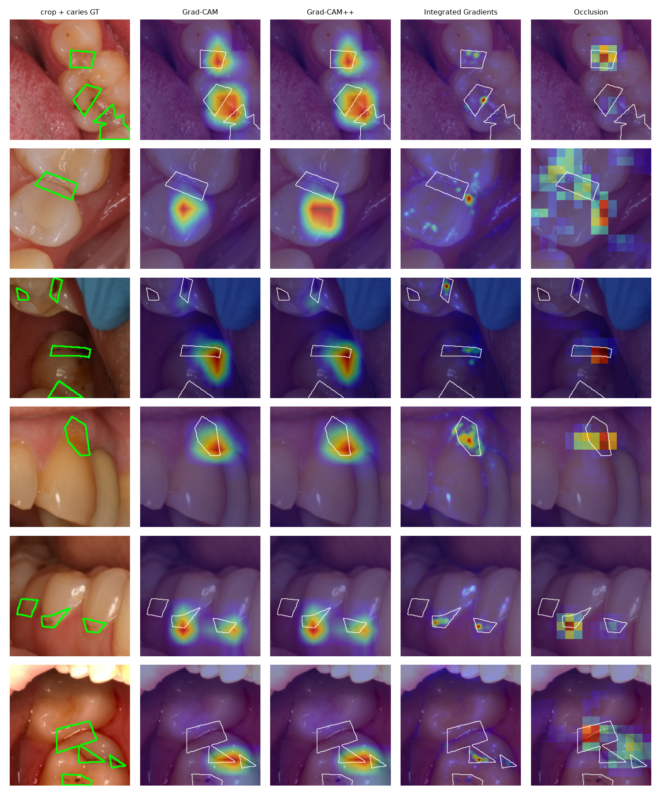
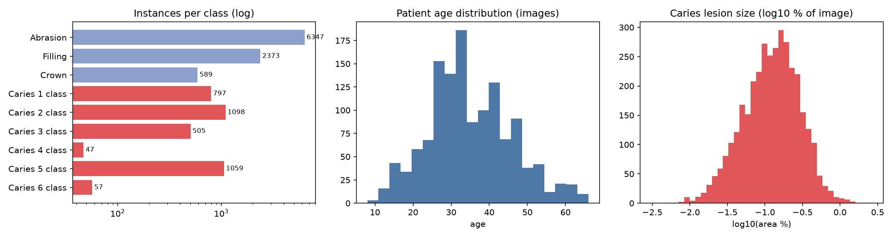
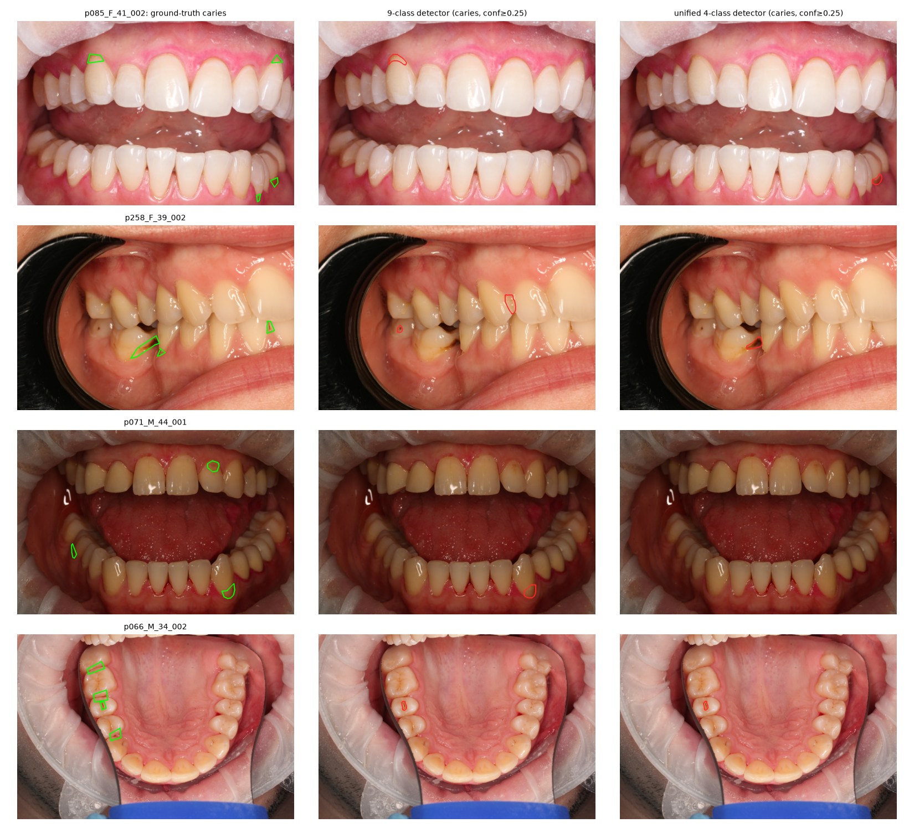
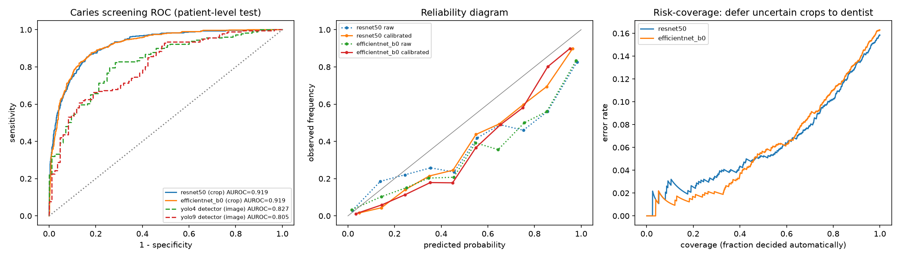
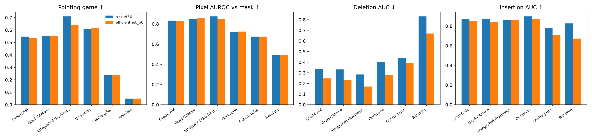

# CariesXAI

### Deep Learning for Dental Caries Detection Using Intraoral Images: Datasets, Models, and Explainability

An end-to-end, reproducible study of caries detection on intraoral photographs. It covers the following:

* a **patient-level benchmark** built from the public AlphaDent dataset,
* **two detectors** (9-class and clinically unified 4-class YOLO11-seg),
* **two screening CNNs** (ResNet-50 and EfficientNet-B0),
* a **quantitative explainability audit**, in which saliency maps are scored against expert lesion masks, against trivial baselines and by perturbation faithfulness,
* **calibration, selective prediction, demographic subgroup analysis and a measured data-leakage experiment.**

The motivation, research questions and design choices are in [docs/PROJECT.md](docs/PROJECT.md).


*Held-out test patients. Column 1 shows the crop with the expert caries outline. The other columns show where ResNet-50 "looks" according to four explanation methods (white = expert outline).*

---

## Key findings

All numbers come from a held-out test set of **57 patients (266 photos)** who were never seen during training or model selection. 95 % confidence intervals come from a patient-level cluster bootstrap.

| # | Question | Finding |
|---|----------|---------|
| 1 | **How much does a naive split inflate results?** | With crops split at random instead of by patient, test AUROC rises from **0.919 to 0.950** for both backbones. Image/crop-level splitting overstates performance by about 3 AUROC points. |
| 2 | **Does merging Black's 6 caries classes into one class help?** | **Not for localisation.** Unified caries AP50 is **0.290** (4-class) vs **0.289** (9-class). Image-level screening AUROC is slightly higher with the unified model (0.827 vs 0.805), but the CIs overlap heavily. |
| 3 | **How well can caries be screened?** | Crop classifiers reach **AUROC 0.919** [0.903, 0.934] (ResNet-50) and **0.919** [0.901, 0.936] (EfficientNet-B0). On caries vs restorations only (fillings, crowns, abrasions) AUROC is still **0.919 / 0.912**. Whole-photo screening from the detector reaches AUROC 0.83. |
| 4 | **Which explanations can be trusted?** | **Integrated Gradients** gives the best agreement with expert masks (pointing game **71 %**, pixel AUROC 0.87) and the best faithfulness (lowest deletion AUC). Grad-CAM, the de facto standard in dental AI papers, is mid-pack (55 %). All four methods clearly beat a centre-prior baseline (24 %) and random maps (5 %). |
| 5 | **Can uncertain cases be referred to a dentist?** | Yes. Automating only the 70 % most confident crops cuts the error rate from **15.8 % to 7.9 %** (ResNet-50). Temperature scaling did **not** improve ECE on the test set (0.090 to 0.093). The miscalibration is not a simple global over-confidence. |
| 6 | **Is performance equal across groups?** | The crop classifiers are consistent across sex and age bands (AUROC 0.91 to 0.93, overlapping CIs). The image-level detector score is weaker for patients **under 30** (AUROC 0.67 to 0.74 vs 0.87 for 30 to 44). This is a small subgroup (n = 82 photos) and is flagged for further study. |

---

## 1. Data: AlphaDent, re-split by patient

[AlphaDent](https://huggingface.co/datasets/ZFTurbo/AlphaDent) (Sosnin et al., 2025, [arXiv:2507.22512](https://arxiv.org/abs/2507.22512), Apache-2.0) contains DSLR intraoral photographs with polygon masks for 9 classes: abrasion, filling, crown, and caries by Black's classes 1 to 6. The official test labels are not public, so the 1,320 labelled photos were **re-split by patient**, stratified on sex × age band (`src/prepare_data.py`, seed 42). No patient appears in more than one split.

| split | patients | photos | photos with caries | female % | mean age | caries instances |
|---|---|---|---|---|---|---|
| train | 205 | 921 | 643 | 54.0 | 34.8 | 2,541 |
| val | 31 | 133 | 86 | 54.9 | 34.0 | 404 |
| test | 57 | 266 | 181 | 54.5 | 36.4 | 618 |



The class distribution is very long-tailed: caries classes 4 and 6 have only 47 and 57 instances in total, and class 4 has none in the test patients. Caries lesions are tiny: the median lesion covers 0.13 % of the photo, and 97 % cover less than 0.5 %.

## 2. Lesion detection and segmentation (YOLO11n-seg)

Two YOLO11n-seg models were trained at 1024 px for 80 epochs on identical images and splits. They differ only in the label space.

| Model | box mAP50 | mask mAP50 | mask mAP50:95 | **Caries AP50 (unified)** | Caries AP50:95 | Screening AUROC [95 % CI] | Sens / Spec* |
|---|---|---|---|---|---|---|---|
| `yolo9`: 9 classes | 0.362 | 0.350 | 0.203 | **0.289** | 0.106 | 0.805 [0.741, 0.865] | 0.65 / 0.81 |
| `yolo4`: unified 4 classes | 0.535 | 0.528 | 0.341 | **0.290** | 0.109 | 0.827 [0.780, 0.871] | 0.80 / 0.72 |

\*The threshold was chosen on the validation split (Youden's J) and applied unchanged to the test split.

**Why the "Caries AP50 (unified)" column matters:** the native mAP of the 4-class model looks much better (0.53 vs 0.35). That gap comes almost entirely from no longer averaging over the rare, poorly detected caries sub-classes. When both models are scored on the *same* task (any caries, with the 9-class predictions mapped to "Caries"), they are equivalent. Comparing native mAP across label spaces is therefore misleading.

Per-class mask AP50 for the 9-class model shows where the difficulty lies:

| Abrasion | Filling | Crown | Caries 1 | Caries 2 | Caries 3 | Caries 5 | Caries 6 |
|---|---|---|---|---|---|---|---|
| 0.755 | 0.629 | 0.495 | 0.238 | 0.200 | 0.066 | 0.382 | 0.036 |

Caries recall (confidence ≥ 0.25, IoU ≥ 0.3) rises with lesion size, from 0.26 for small lesions to 0.38 for large ones (9-class model). Small and early lesions remain the main open problem.


*Green: expert caries outlines. Red: predicted caries masks. The examples are test patients picked at random.*

Training curves: [`results/training/`](results/training).

## 3. Crop-level caries screening

The crop dataset (`src/make_crops.py`) holds 224 px crops from the 1280 px photos: 3,178 caries crops, 3,177 *hard negatives* centred on fillings, crowns or abrasions, and 2,640 random caries-free crops. **Every crop keeps its pixel mask**, which makes the XAI audit possible.

| Backbone | AUROC [95 % CI] | AUPRC | Sens | Spec | Caries vs restorations AUROC | AUROC with leaky random split |
|---|---|---|---|---|---|---|
| ResNet-50 | **0.919** [0.903, 0.934] | 0.854 | 0.833 | 0.846 | 0.919 | 0.950 |
| EfficientNet-B0 | **0.919** [0.901, 0.936] | 0.841 | 0.808 | 0.872 | 0.912 | 0.950 |



**Left:** ROC on the test patients. Crop classifiers work on a localised region; detector curves are whole-photo screening. **Middle:** reliability diagram. Both CNNs are over-confident at high scores. Temperature scaling fitted on validation (T ≈ 1.9) moves the curves but does not lower test ECE (ResNet-50: 0.090 raw vs 0.093 calibrated; EfficientNet-B0: 0.101 vs 0.096). **Right:** risk-coverage. Uncertain crops are deferred to a dentist:

| Automated coverage | 100 % | 90 % | 80 % | 70 % |
|---|---|---|---|---|
| ResNet-50 error | 15.8 % | 13.4 % | 10.3 % | **7.9 %** |
| EfficientNet-B0 error | 16.3 % | 13.4 % | 11.0 % | **8.8 %** |

### Subgroups (test AUROC, ResNet-50 crops)

| female | male | age < 30 | 30 to 44 | ≥ 45 |
|---|---|---|---|---|
| 0.924 | 0.914 | 0.911 | 0.924 | 0.918 |

All patient-bootstrap CIs overlap; see `results/final_metrics.json` for CIs and the EfficientNet-B0 and detector subgroups.

## 4. Explainability audit

`src/xai_eval.py` runs the audit on 300 randomly sampled caries crops from the test patients for each backbone. Six saliency maps are computed per crop:

* **Grad-CAM**, **Grad-CAM++**: last convolutional block
* **Integrated Gradients**: 32 steps, *blurred* baseline. A black image is out of distribution for photos.
* **Occlusion**: 32 px blurred patches, stride 16
* **Centre prior** and **Random**: sanity baselines that any method must beat

| Metric | What it measures |
|---|---|
| Pointing game ↑ | Saliency peak within 8 px of the expert lesion |
| Relevance mass / lift ↑ | Share of saliency inside the lesion, and that share divided by the lesion's area share |
| Pixel AUROC ↑ | The saliency map used as an unsupervised lesion segmenter |
| Deletion AUC ↓ | Model confidence as the most salient pixels are blurred away (faithfulness) |
| Insertion AUC ↑ | Model confidence as the most salient pixels are restored |



| Method | Pointing ↑ | Mass ↑ | Lift ↑ | Pixel AUROC ↑ | Deletion ↓ | Insertion ↑ |
|---|---|---|---|---|---|---|
| **ResNet-50** | | | | | | |
| Grad-CAM | 0.547 | 0.192 | 4.35 | 0.834 | 0.337 | 0.871 |
| Grad-CAM++ | 0.553 | 0.185 | 4.12 | 0.853 | 0.332 | 0.873 |
| Integrated Gradients | **0.710** | 0.219 | 5.31 | **0.875** | **0.285** | 0.861 |
| Occlusion | 0.607 | **0.231** | **5.69** | 0.718 | 0.402 | **0.898** |
| Centre prior | 0.237 | 0.076 | 1.40 | 0.674 | 0.444 | 0.781 |
| Random | 0.050 | 0.053 | 1.00 | 0.494 | 0.832 | 0.827 |
| **EfficientNet-B0** | | | | | | |
| Grad-CAM | 0.537 | 0.148 | 3.29 | 0.825 | 0.248 | 0.851 |
| Grad-CAM++ | 0.553 | 0.170 | 3.84 | **0.854** | 0.233 | 0.837 |
| Integrated Gradients | **0.643** | 0.161 | 3.78 | 0.848 | **0.170** | 0.861 |
| Occlusion | 0.617 | **0.200** | **5.20** | 0.725 | 0.282 | **0.870** |
| Centre prior | 0.237 | 0.076 | 1.40 | 0.674 | 0.390 | 0.707 |
| Random | 0.050 | 0.053 | 1.00 | 0.494 | 0.670 | 0.673 |

**Takeaways**

* All four methods focus on the lesion far more than chance: relevance lift is 3 to 6×, meaning 3 to 6 times more saliency inside the lesion than its area alone would give. The models really do use the carious tissue, not the crop centre or the background.
* **Integrated Gradients is the best all-rounder.** It is the most plausible by pointing game and pixel AUROC, and the most faithful by deletion. We recommend it over Grad-CAM for dental-photo models.
* **Occlusion puts the most mass on lesions but is coarse.** Its 32 px patches limit pixel AUROC.
* **Grad-CAM++ adds little over Grad-CAM** on these models.
* Insertion AUC separates the methods poorly: even random maps score high, because the blurred image alone keeps much of the model's confidence. Deletion is the more informative faithfulness metric here.
* Even the best method points outside the expert outline in about 30 % of cases. Saliency maps should support, not replace, clinical judgement.

---

## Reproduce

```bash
git clone git@github.com:HessamKaveh/caries-xai.git && cd caries-xai
python -m venv .venv && source .venv/bin/activate && pip install -r requirements.txt

# AlphaDent (4.9 GB)
mkdir -p ~/caries-xai-data/raw && cd ~/caries-xai-data/raw
curl -L -o AlphaDent.zip https://huggingface.co/datasets/ZFTurbo/AlphaDent/resolve/main/AlphaDent.zip
unzip -q AlphaDent.zip -d alphadent && cd -

scripts/run_all.sh          # full pipeline, about 4 h on a 4 GB RTX 500 Ada laptop GPU
```

The pipeline is **resumable**. Each stage skips itself if its outputs exist, YOLO continues from `last.pt`, and the classifiers continue from per-epoch checkpoints. You can kill it and run it again at any time. Set `CARIES_RAW` if the data lives elsewhere.

| Stage | Script | Output |
|---|---|---|
| Patient-level split, YOLO datasets, stats | `src/prepare_data.py` | `data/`, `results/dataset_summary.*` |
| Crops with lesion masks | `src/make_crops.py` | `data/crops/` |
| Detectors (9 and 4 classes) | `src/train_yolo.py` | `weights/yolo*_*.pt` |
| Screening CNNs (+ leaky control) | `src/train_cls.py` | `weights/cls_*.pt`, `results/cls_*` |
| Explainability audit | `src/xai_eval.py` | `results/xai_*` |
| Detector evaluation | `src/eval_detection.py` | `results/det_*` |
| Detection figure | `src/visualize_detection.py` | `results/figures/detection_examples.png` |
| Calibration, selective, subgroups, CIs | `src/analysis.py` | `results/final_metrics.json`, figures |

Trained weights are attached to the [GitHub release](../../releases).

## Repository layout

```
docs/PROJECT.md        project definition: motivation, research questions, methods, limitations
src/                   pipeline (one script per stage, shared helpers in common.py)
scripts/run_all.sh     resumable end-to-end runner
results/               every number and figure reported above
  final_metrics.json   all metrics incl. CIs and subgroups
  figures/             PNG figures
  training/            YOLO training curves
```

## Limitations

* **Single source.** AlphaDent comes from one clinical setting and one camera type. No external validation was possible, and smartphone photos may behave differently.
* The crop task is easier than real screening, because crops are sampled around annotations. The detector's whole-photo AUROC (0.83) is the more realistic screening estimate.
* Caries classes 4 and 6 are too rare to evaluate reliably. Detector subgroup estimates (for example age < 30) rest on small numbers.
* Each model was trained once (seed 0). Run-to-run variance is not reported apart from the bootstrap over patients.
* This is research code, **not a medical device**.

## Citation

If you use the data, please cite AlphaDent:

```bibtex
@article{sosnin2025alphadent,
  title   = {AlphaDent: A dataset for automated tooth pathology detection},
  author  = {Sosnin, Evgeniy I. and Vasilev, Yuriy L. and Solovyev, Roman A. and others},
  journal = {arXiv preprint arXiv:2507.22512},
  year    = {2025}
}
```

## License

Code: MIT. The AlphaDent data is Apache-2.0 and is **not** redistributed here; the figures contain derived crops of it.
